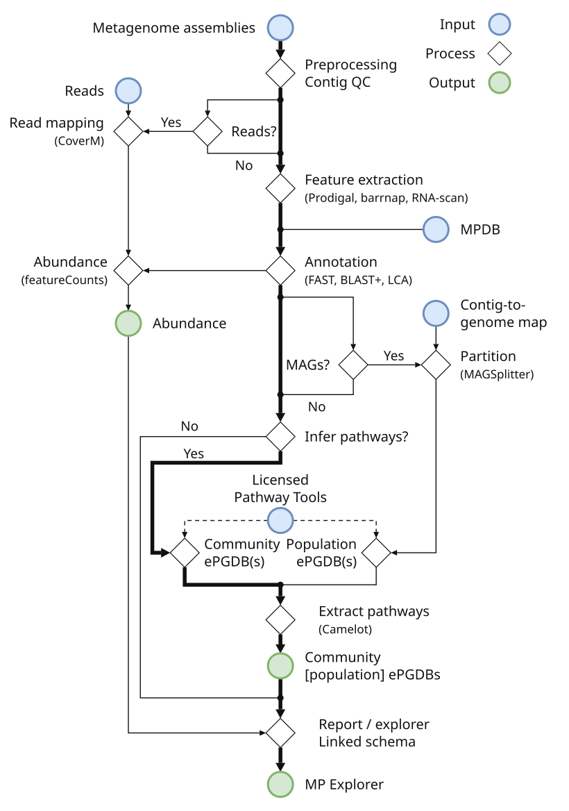

# MetaPathways

Annotate metagenomes, measure read abundance, infer community and genome pathways, and explore the results. Run on a local server or submit work through Slurm using the same commands.

**New users:** start with [installation and the three-sample test](installation.md). The small input dataset and workflow helpers are included. **Want PGDBs? Follow the [Pathway Tools installation guide](pathway-tools.md) before running the complete workflow.**

```{container} mp-primary-workflow mp-workflow-overview
[](assets/workflow-brief-nodal.svg)
```

Follow the heavy main path through preprocessing, feature extraction, annotation and optional community pathway inference. Side branches add read abundance and population ePGDBs. Blue circles are inputs, green circles are outputs, and diamonds are processes or choices; black dots mark connected junctions. Dashed lines supply licensed Pathway Tools. All available results feed the report and explorer. [View the SVG](assets/workflow-brief-nodal.svg) · [Download PDF](assets/workflow-brief-nodal.pdf) · [Workflow diagrams and tool citations](detailed-workflow.md).

Tool labels are abbreviated in this overview: Prodigal runs through pProdigal, and RNA scanning uses the ptRNAscan-SE wrapper around tRNAscan-SE. See the detailed workflow for the full software descriptions.

## Start simple

```{toctree}
:maxdepth: 1
:caption: Getting started

overview
installation
getting-started
containers
test
test-bundle
cami-references
```

## Run your analysis

```{toctree}
:maxdepth: 1
:caption: Analysis guides

inputs
databases
pathway-tools
analysis
annotation
pgdb-workflow
commands
resources
execution
troubleshooting
```

## Understand and explore

```{toctree}
:maxdepth: 1
:caption: Results and reference

reports-tutorial
reports-reference
results-schema
architecture
data-flow
detailed-workflow
workflow
cli-reference
benchmarking
reproducibility
```

## Maintain and contribute

```{toctree}
:maxdepth: 1
:caption: Development

pr-testing
releasing
release-readiness
documentation
```

Source code and documentation: [GitHub](https://github.com/hallamlab/MetaPathways). Questions, bugs and feature requests: [GitHub issues](https://github.com/hallamlab/MetaPathways/issues). See the [README](https://github.com/hallamlab/MetaPathways#team-support-and-citation) for contributors and citation.
